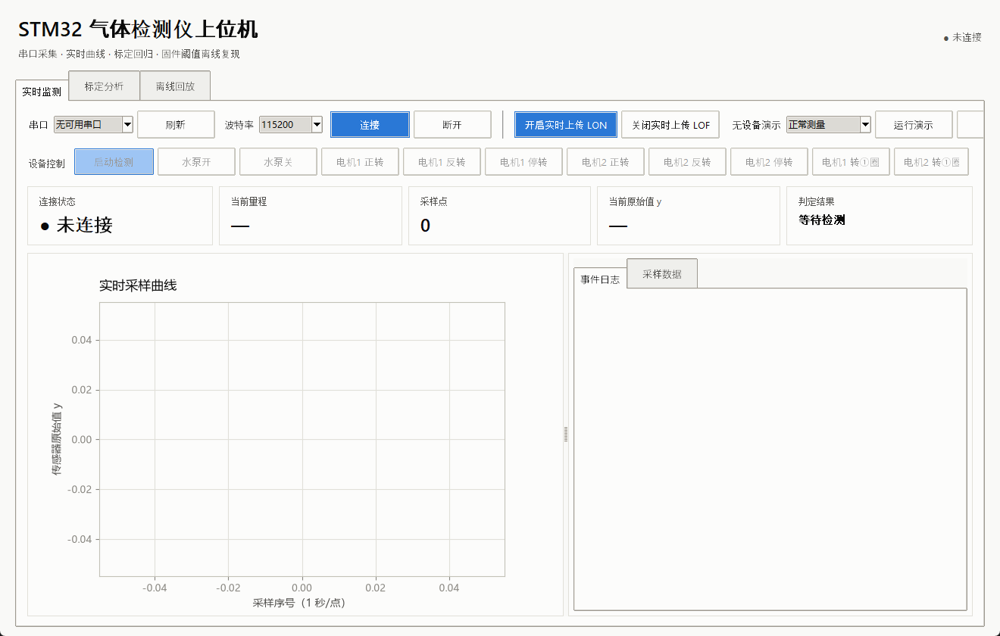
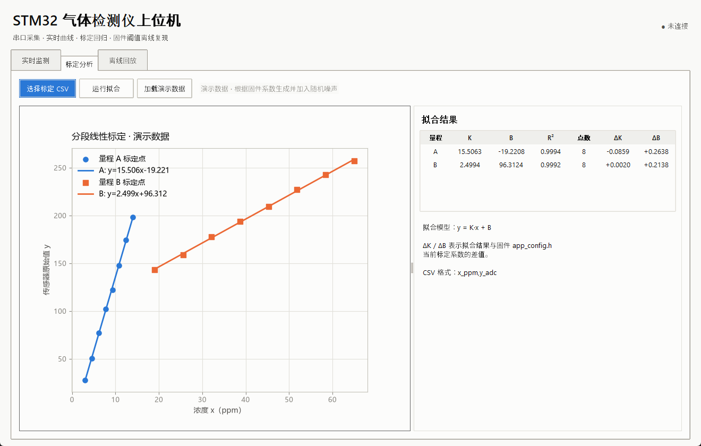
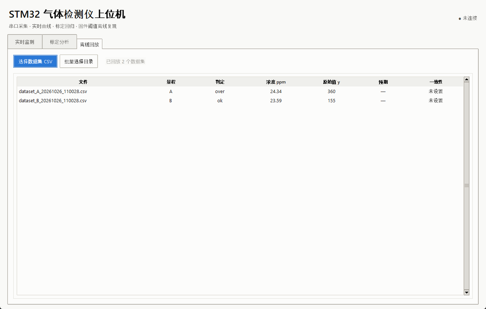
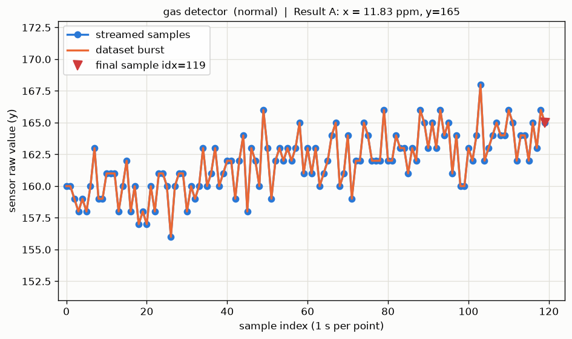
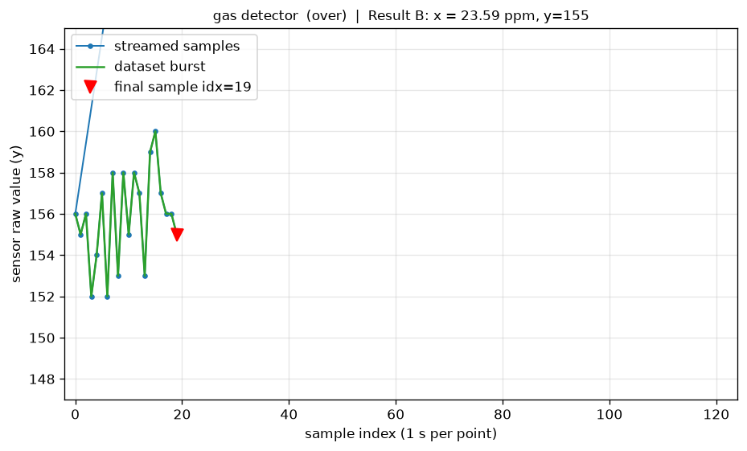
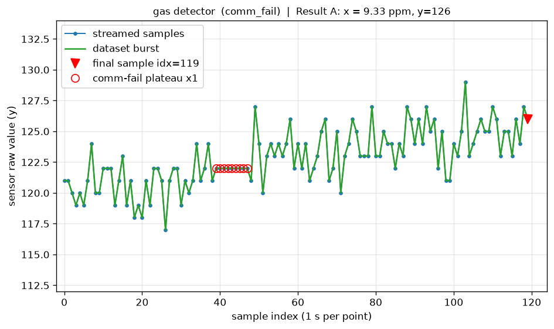

# gas_host：气体检测仪 PC 上位机工具

与固件（`Core/Src/console.c` / `app.c`）串口协议配套的上位机工具：串口采集、实时曲线、标定拟合、离线回放交叉验证。纯 Python 实现，依赖 `pyserial` / `numpy` / `matplotlib`。

## 功能

| 功能 | 说明 |
|---|---|
| 图形界面 | Tkinter 三页签窗口：实时监测、标定分析、离线回放；可双击启动，无需输入命令 |
| 串口采集 | 解析固件 UART 文本协议（STREAM 采样流 / Countdown Data 突发帧 / Result 结果行），原始字节落盘 `logs/`，数据集保存为 CSV |
| 实时曲线 | matplotlib 直播 STREAM 采样点；数据集整段叠加显示；标记固件实际参与判定的最终采样点（A: 索引 119，B: 索引 19） |
| 异常标记 | 固件在 Modbus 失败时沿用上一次读数，连续 ≥5 个等值点判为通信失败区间，红圈标出 |
| 标定拟合 | 标定点分段线性回归 `y = K*x + B`，输出 K / B / R² 并与固件系数（`app_config.h`）对比 |
| 离线复现 | 用与固件 STATE_RESULT 完全一致的阈值逻辑回放历史数据集，支持 `# expect=` 注释自动比对，批量输出一致性 |
| 设备模拟 | 无实物时按固件输出格式生成模拟数据（正常 / 超量程切换 / 通信失败三种场景） |

## 使用方法

### 图形界面（推荐）

Windows 下直接双击：

```text
启动上位机.bat
```

也可以在命令行启动：

```bash
python gas_host.py gui
```

实时监测页支持：串口选择、连接/断开、`LON`/`LOF`、曲线缩放、采样表、事件日志、CSV 自动保存，以及正常/超量程/通信失败三种无设备演示。

### 命令行工具

```bash
pip install -r requirements.txt

# 无设备演示（三种场景：normal / over / comm_fail）
python gas_host.py capture --simulate --scenario normal
python gas_host.py capture --simulate --scenario over --screenshot docs/demo_over.png

# 连接真实设备（固件需先发送 LON 开启流式输出）
python gas_host.py capture --port COM3 --out runs/run1

# 标定拟合（CSV 格式：x_ppm,y_adc），--demo 用仿真点验证可复现固件系数
python gas_host.py calibrate --csv calib_points.csv
python gas_host.py calibrate --demo

# 离线回放交叉验证
python gas_host.py replay --csv runs/run1/data/dataset_A_xxxx.csv
python gas_host.py replay --dir runs/run1/data

# 协议解析单元测试
python gas_host.py selftest
```

## 图形界面

实时监测（通信失败演示，红圈为固件沿用旧值形成的平台段）：



标定分析（两段拟合曲线及 K/B/R² 对比表）：



离线回放（逐文件复现固件判定逻辑）：



## 曲线导出示例

normal（量程 A 正常测量，红色三角为固件判定用最终采样点）：



over（量程 A 超量程 → 触发稀释 → 量程 B 出结果）：



comm_fail（中段 Modbus 失败平台段被红圈标出，固件沿用旧值继续判定）：



## 标定拟合示例

`calibrate --demo` 由固件标定方程生成含噪声的仿真标定点，再拟合回归，验证工具可复现固件系数：

```text
stage           K          B      R^2   n  dK(vs FW)  dB(vs FW)
A         15.5063   -19.2208  0.9994   8     -0.0859    +0.2638
B          2.4994    96.3124  0.9992   8     +0.0020    +0.2138
```

## 协议格式

```text
STREAM,<stage>,<index>,<value>\r\n        ; LON 开启后倒计时期间每秒一行
--- Countdown Data ---\r\n                ; 倒计时结束后的完整数据集
v0,v1,...,vN\r\n
--- End of Data ---\r\n
Result A: x = 12.34 ppm, y=171\r\n         ; 判定结果行
```

数据集 CSV 首行可写 `# expect=ok`（或 `lod` / `over` / `error`），`replay` 会自动比对并输出一致性统计。
